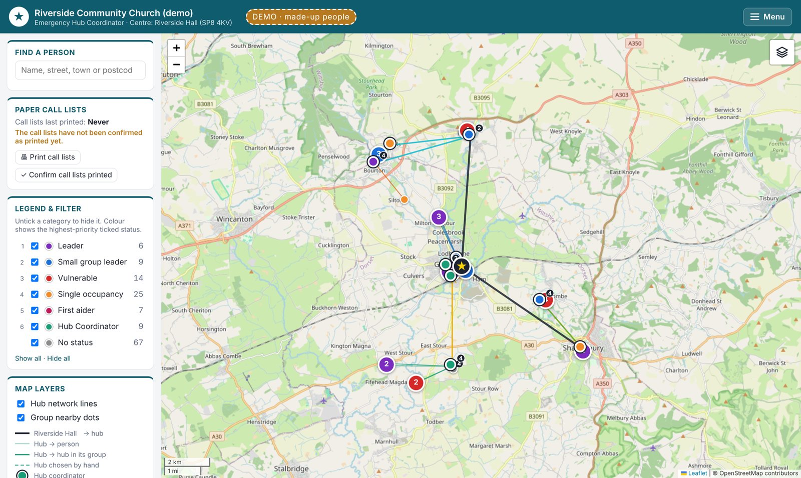
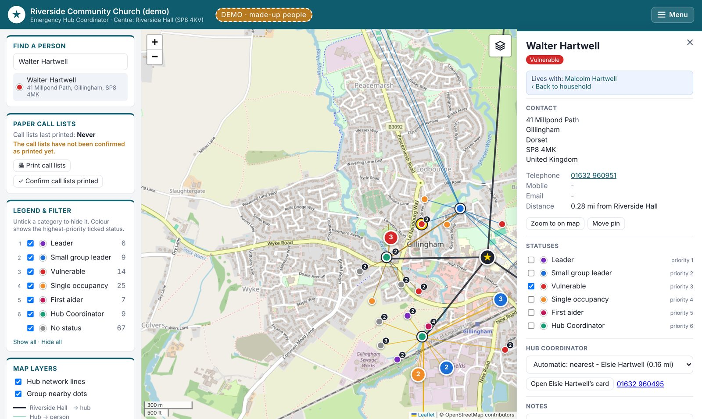
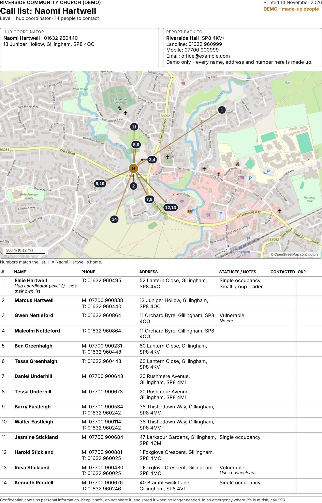

# Emergency Hub Coordinator

A small website, run on your own computer, for planning emergency contact across a church
community. It maps everyone in the church address list, lets you tag people with statuses, and
builds a hub-and-spoke network: **your church → hub coordinators → the people nearest each hub**,
with printed call lists for each hub.

Everything stays on your computer. There's no central server and no account to sign up for.
Free and open source under the MIT licence.



*All the screenshots here use the built-in demo church. Every name, address and phone number in it is made up.*

## What it does

- **Maps your church family.** Everyone at the same address shares one dot, coloured by their most
  important status (vulnerable, lives alone, leader, first aider, or your own statuses).
- **Plans who rings whom.** Pick hub coordinators and everyone else is linked to the one who lives
  nearest, with the option to choose by hand. Larger churches can have hubs within hubs.
- **Prints the call lists.** Each hub coordinator gets their own pages, with a map of their group,
  phone numbers, notes and tick boxes. The app reminds you when the paper copies are out of date.
- **Keeps itself current.** Upload a CSV from any church database, or sync straight from
  [ChurchSuite](#using-it-with-churchsuite).
- **Looks after the data.** Optional encryption with a passphrase, a Data Protection Pack explaining
  your responsibilities under UK law, and nothing sent anywhere except what's needed to put
  postcodes on the map.

<p>
  
  
</p>

*Left: a person's card, where you tick their statuses and see their hub coordinator. Right: a printed call list for one hub.*

## Installing it (Windows)

1. Go to the [Releases page](https://github.com/petebond/Emergency-Hub/releases/latest) and download
   **EmergencyHub-x.y.z-windows.zip**.
2. Right-click the zip, choose **Properties**, tick **Unblock** and click OK. (This stops Windows asking
   whether you trust it every time it starts.)
3. Unzip it somewhere permanent, such as your Documents folder: right-click → **Extract All**. Don't run it
   from inside the zip.
4. Open the **Emergency Hub Coordinator** folder and double-click **Emergency Hub**. A black window opens and
   your browser goes to <http://127.0.0.1:8765>. Keep that window open while you use the app; close it to stop.

The folder looks like this:

```
Emergency Hub Coordinator\
   Emergency Hub          the shortcut to double-click (copy it to the desktop if you like)
   app\                   the program, including its own copy of Python - updates replace this
   data\                  your contacts, settings, backups and config.json - back this up
```

`data` appears the first time you start it. Nothing else needs installing. It opens in demo mode the
first time. Everything is in the **Menu** button in the top right, including **Help and quick start**.

If Windows shows "Windows protected your PC", click **More info** then **Run anyway**. It does that for
programs from the internet that aren't signed by a software company.

## Updating

The app checks once a day for a new version (you can turn this off). When there is one, an orange dot
appears on the Menu button. **Settings → About & updates** shows what's new and installs it with one
click: the app downloads the update, checks it against the SHA-256 fingerprint published with the
release, keeps the current version so you can go back, puts the new files in place and restarts.

An update only replaces program files inside `app` (`server.py`, `VERSION`, `static`, `demo`, `tools` and
the documents). It never touches `data` (including `config.json`), the launcher or the bundled `python` folder. The
check only contacts GitHub (api.github.com and its download servers), which sees your internet address
and nothing else.

To update by hand instead, download the new Windows zip, unzip it, and copy your `data` folder into the new
folder.

## Using it with ChurchSuite

If your church uses [ChurchSuite](https://churchsuite.com), the app can fetch your contact list
directly instead of you exporting and uploading a CSV file. It uses the ChurchSuite API v2.

**What it does and doesn't do**

- **Read-only.** It asks ChurchSuite for the `addressbook.read` permission only, and never creates,
  changes or deletes anything in ChurchSuite.
- **Only the people you choose.** You tick which ChurchSuite tags to include (for example Attender
  and Partner), and it fetches active contacts with any of those tags. Nobody else is downloaded.
- **Only the details it needs:** names, address, phone numbers and email. ChurchSuite's own map
  position is used when a contact has one, so fewer postcodes need looking up.
- **Your keys stay with you.** The Client ID and Secret are stored only on the church's own computer
  (in `data/churchsuite.json`, encrypted if encryption is turned on), and are only ever sent to
  ChurchSuite's own sign-in server.
- **No middleman.** The app talks directly to `login.churchsuite.com` and `api.churchsuite.com`. There's
  no Emergency Hub server in between, and the developers never see your data.
- **Safe syncing.** People are matched by their ChurchSuite record, so statuses, notes and hub choices
  carry over each time. If a sync would remove a large share of your list (more than 30%, and more
  than five people), usually because a tag has been changed, the app stops and asks first. A backup
  is taken before every sync, and it waits politely if ChurchSuite asks it to slow down.

**Setting it up**

1. In ChurchSuite, an Administrator creates a dedicated user with **view-only Address Book**
   permission, turns on API access for it, and generates a **Client ID** and **Client Secret**.
2. In the app, open **Menu → Settings → Data & privacy**, paste both in and click **Connect to
   ChurchSuite**.
3. Tick the tags to include. The app shows how many people that covers.
4. Choose **Menu → Sync from ChurchSuite** whenever you want the latest list. You'll see a report of
   who was added, removed or changed.

## Running from the source code

If you'd rather not use the release download, clone this repository and run `python app/server.py` with
Python 3.10 or newer. Only the standard library is used. Your data goes in a `data` folder at the top of
the repository, which git ignores.

## Demo mode

A new installation opens in **demo mode**: a made-up church ("Riverside Community Church") with
119 fictional people around Gillingham, so you can show the system to others safely. An orange
**DEMO** badge sits in the title bar and printed call lists are marked as demo.

- Every name, street and postcode is invented. The postcodes end in letters that real UK
  postcodes never use (C, I, K, M, O, V), phone numbers are from Ofcom's ranges reserved for
  TV and film (07700 900xxx, 01632 960xxx), and emails use `example.com`. The dots are scattered
  around village centres, not placed on real houses.
- Turn the demo on or off under **Settings → Data & privacy → Demo mode**. You can also choose
  **Show the demo instead** on the lock screen.
- The demo is kept in `data/demo/` and never touches your real data. Turning it on locks
  encrypted real data, so it needs the passphrase again when you turn the demo off.
- CSV upload, ChurchSuite and encryption are switched off in the demo. Everything else can be
  tried freely, and **Reset demo data** puts it back as it started.
- `tools/make_demo.py` rebuilds the demo list (`demo/demo-data.json`).

## Day-to-day use

| What | How |
|---|---|
| ChurchSuite | In **Settings → Data & privacy**, enter the Client ID and Secret of a dedicated ChurchSuite API user (view-only Address Book permission) and press **Connect to ChurchSuite**. Your ChurchSuite tags then appear as tick boxes (grouped by category); tick the ones to include (e.g. Attender, Partner). The tag list is refreshed on every sync, and tags are remembered by their ChurchSuite ID, so renaming a tag in ChurchSuite does not break anything. **Sync from ChurchSuite** then fetches everyone with any of those tags and updates the list the same way as a CSV upload. It is read-only and never changes ChurchSuite. People are matched by their ChurchSuite record, and ChurchSuite's own map positions are used where available. If a sync would remove a large share of people, you are asked to confirm first. |
| Load or refresh contacts | **Upload contacts CSV** (or drag a CSV onto the page). Each upload counts as the *complete* list. New people are added, people missing from the file are removed, and changed details are updated. |
| See what an upload changed | The changes report opens after every upload. Older reports are under **Changes report**. |
| Table view | **Table view** lists everyone in a scrollable table with a tick box for each status, so you can set statuses (including Hub Coordinator) quickly after the first upload. Filter by status, search by name, or enter a postcode and a distance (for example SP8 4GR, 0.5 miles) to list only people within that distance. Click a column heading to sort. The map is not affected. |
| Contact card | Click a dot. Clicking a numbered cluster zooms in, or fans the dots out when they share an address or postcode. |
| Households | People with exactly the same address share one dot. A small number on the dot shows how many live there. Hover to list their names, or click to see the household and open each person's card. Spelling such as Road/Rd and punctuation are ignored when comparing addresses. |
| Statuses | Tick boxes on the card: Leader, Small group leader, Vulnerable, Single occupancy, Hub Coordinator. A person can have more than one. |
| Dot colour | The highest-priority status: Leader > Small group leader > Vulnerable > Single occupancy > Hub Coordinator. Grey means no status. Hub coordinators have a dark ring and are never grouped into clusters. |
| Filter | Tick or untick categories in the legend. A person is shown if *any* of their ticked statuses is switched on. |
| Hub assignment | By default everyone is linked to their nearest hub coordinator in a straight line. To choose a different hub, use the drop-down on the person's card. A manual choice shows as a dashed line and is kept until you change it. |
| People not on the map | **Not on map** lists anyone whose address is missing, incomplete or not recognised, plus anyone whose position is only approximate. You can also **Place on map by hand**. |
| Call lists | **Hub groups** lists each hub's people with their phone numbers. You can print it. |
| Grouping levels | For larger organisations, set **Grouping levels** in Settings to 2 or more. A level 2 hub coordinator belongs to the group of the nearest level 1 hub coordinator, and so on down. Everyone else joins their nearest hub coordinator of any level. Set each hub coordinator's level on their card or in Table view. Each group and call list shows only the people directly in it. |
| Settings | **Settings** (in the menu, top right) sets your organisation's name and logo for the title bar (each can be hidden), light or dark mode, the central hub's name, location (by postcode, or by clicking a spot on the map) and marker (colour, size, and a star, your logo or another image), the status colours, dot size, line widths and line colours. **Dark mode** / **Light mode** in the menu switches between them. Settings are saved in the `data` folder, so they move with it. |
| Statuses | **Settings → Statuses** lets you rename, recolour, reorder (priority), add and remove statuses. Hub Coordinator can be renamed but not removed. |
| Encryption | **Settings → Data & privacy → Encryption** encrypts the contact data, backups and ChurchSuite details with a passphrase (at least 12 characters). The app then asks for it when it starts, when **Lock now** in the menu is clicked and after the auto-lock time. **If the passphrase is lost the data cannot be recovered.** |
| Data Protection Pack | **Settings → Data & privacy → Create Data Protection Pack** downloads a PDF in your branding explaining your responsibilities under UK data protection law, with a privacy notice paragraph, a risk assessment outline, a hub coordinator confidentiality agreement and checklists. General guidance, not legal advice. |
| Map without internet | Every part of the street map you view is stored on this PC (in `data/tiles`, up to 500 MB) and used first, so areas you have looked at still show if the internet is down. Browse and zoom in on your area beforehand. The satellite view always needs the internet. Clear the stored map in Settings → Look and feel. (OpenStreetMap's rules don't allow downloading whole areas in advance.) |
| Backup / spreadsheet | **Export CSV** downloads everyone with their statuses, hub and notes. |

### How people are matched between uploads
People are matched by **first name + last name**. If two people have the same name, their
postcode or email tells them apart. A surname change is still matched when the first name and
the email or mobile number stay the same. Statuses, hub choices, notes and hand-placed pins
carry over to the next upload.

### How addresses are located
UK postcodes are looked up with the free **postcodes.io** service. If a postcode is missing or
not recognised but the street and town are there, the app tries **OpenStreetMap Nominatim**
with the street address. Those positions are marked *approximate* so you can check them. Only
the address details are sent to these services. Names, phone numbers, emails, statuses and
notes never leave this PC.

## Files

- `data/contacts.json`: all contacts, statuses and upload reports. **Back this folder up.**
- `data/backups/`: an automatic copy taken before each upload (the last 30 are kept).
- `data/geocache.json`: saved postcode lookups.
- `data/images/`: your uploaded logo and central hub image.
- `data/churchsuite.json`: the ChurchSuite Client ID, Secret and tags. Keep this file private.
- `data/vault.json`: present when encryption is on. It holds the salt and a check value (never the passphrase). Without the passphrase the other data files cannot be read.
- `data/update.json`: whether to check for updates, and what the last check found. Nothing personal.
- `data/config.json`: port, and whether other devices can connect. Its centre name and postcode are only used the first time; after that the centre is changed on the Settings page. This file is created on first run.
- `app/.update/`: the previous version's program files, kept after an update so you can go back.

The data includes sensitive information such as who is vulnerable. By default the site only
accepts connections from this PC (`"host": "127.0.0.1"`). To use it from other devices on
your network, set `"host": "0.0.0.0"` in `data/config.json`.

## Moving to Home Assistant / a home server later
The app uses only the standard Python library, so you can copy the folder to any machine
with Python. A `Dockerfile` is included:

```
docker build -t emergency-hub .
docker run -d -p 8765:8765 -v /path/to/data:/app/data emergency-hub
```

Copy your existing `data` folder into the mounted data path to bring everything across.
In Docker the app tells you about new versions but doesn't update itself: rebuild the image instead.

## Publishing a new version (for maintainers)

1. Change the number in `app/VERSION` (for example `1.2.0`) and add a `## [1.2.0] - date` section to
   `CHANGELOG.md`. That section becomes the release notes people see in the app, so write it for them.
2. Commit, then tag and push: `git tag v1.2.0 && git push origin main v1.2.0`.
3. The **Release** GitHub Action checks the code, starts the app, builds the Windows zip (with
   Python) and the update zip, and publishes the release. Every copy of the app will offer it within a day.

The bundled Python version is set at the top of `.github/workflows/release.yml`.
